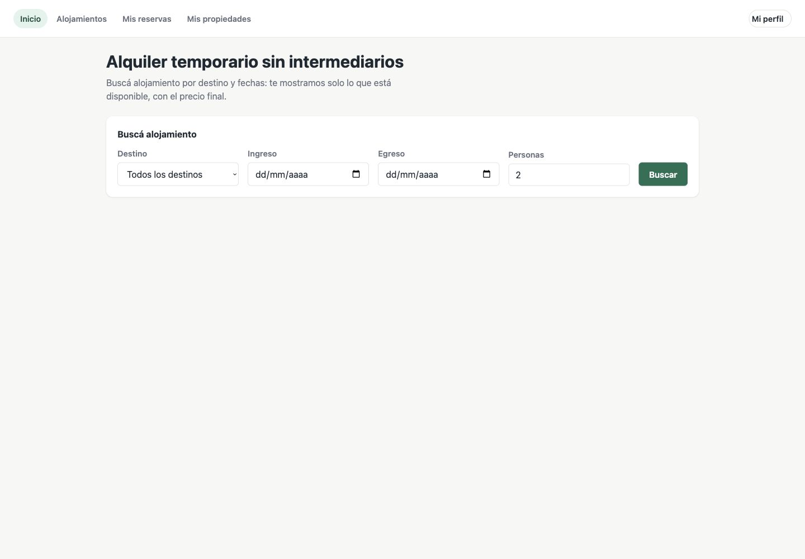
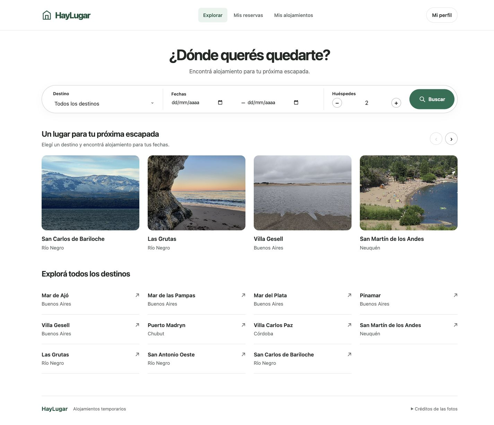

# HayLugar · Antes y después

Registro visual del 31/10/2026. Las capturas usan datos sintéticos del entorno local.

- **31 vistas × 3 etapas = 93 capturas** del rediseño general. Desktop de 1440 × 1000 px, página completa; altura variable.
- [Mejoras posteriores: DNI, contraseña, fotos y cotización](mejoras/README.md).
- [Ingreso, egreso y libro de huéspedes](estadias-libro/README.md).

## Abrir el comparador

Desde la raíz del frontend:

```sh
python3 -m http.server 5500
```

Abrir **http://localhost:5500/docs/comparacion/**. El comparador es estático: no necesita API, sesión ni base de datos. También se puede abrir `index.html` directamente. GitHub muestra las imágenes desde los enlaces de este índice; no ejecuta el visor HTML.

## Qué representa cada etapa

1. **Original:** frontend del commit `54ca5fd6a35ea5db98bf6634c1c51a094fc01cb9`, antes del rediseño.
2. **Primera propuesta:** primera pasada de marca, componentes y calendario.
3. **Segunda pasada:** ajustes de usabilidad sobre nueve vistas, identificados en [revision-2.json](revision-2.json). Las otras 22 conservan su captura anterior.

Estas etapas son históricas. Las galerías de mejoras posteriores muestran cambios que no aparecen en las primeras 93 capturas. No se reemplaza el original para conservar la comparación.

## Pantallas

| Vista | Antes | Primera propuesta | Segunda pasada |
|---|---|---|---|
| Inicio con sesión | [Ver](antes/01-inicio-huesped.jpg) | [Ver](iteracion-1/01-inicio-huesped.jpg) | [Ver](despues/01-inicio-huesped.jpg) |
| Resultados de búsqueda | [Ver](antes/02-resultados.jpg) | [Ver](iteracion-1/02-resultados.jpg) | [Ver](despues/02-resultados.jpg) |
| Detalle del alojamiento | [Ver](antes/03-detalle.jpg) | [Ver](iteracion-1/03-detalle.jpg) | [Ver](despues/03-detalle.jpg) |
| Mis alojamientos | [Ver](antes/04-propietario.jpg) | [Ver](iteracion-1/04-propietario.jpg) | [Ver](despues/04-propietario.jpg) |
| Configurar alojamiento | [Ver](antes/05-configurar-unidad.jpg) | [Ver](iteracion-1/05-configurar-unidad.jpg) | [Ver](despues/05-configurar-unidad.jpg) |
| Calendario y precios | [Ver](antes/06-temporadas.jpg) | [Ver](iteracion-1/06-temporadas.jpg) | [Ver](despues/06-temporadas.jpg) |
| Disponibilidad | [Ver](antes/07-disponibilidad.jpg) | [Ver](iteracion-1/07-disponibilidad.jpg) | [Ver](despues/07-disponibilidad.jpg) |
| Condiciones y cancelación | [Ver](antes/08-politica.jpg) | [Ver](iteracion-1/08-politica.jpg) | [Ver](despues/08-politica.jpg) |
| Datos y fotos | [Ver](antes/09-datos-unidad.jpg) | [Ver](iteracion-1/09-datos-unidad.jpg) | [Ver](despues/09-datos-unidad.jpg) |
| Equipo del alojamiento | [Ver](antes/10-gestion-unidad.jpg) | [Ver](iteracion-1/10-gestion-unidad.jpg) | [Ver](despues/10-gestion-unidad.jpg) |
| Agregar alojamiento | [Ver](antes/11-alta-unidad.jpg) | [Ver](iteracion-1/11-alta-unidad.jpg) | [Ver](despues/11-alta-unidad.jpg) |
| Mi perfil | [Ver](antes/12-perfil.jpg) | [Ver](iteracion-1/12-perfil.jpg) | [Ver](despues/12-perfil.jpg) |
| Inicio público | [Ver](antes/13-inicio-publico.jpg) | [Ver](iteracion-1/13-inicio-publico.jpg) | [Ver](despues/13-inicio-publico.jpg) |
| Iniciar sesión | [Ver](antes/14-iniciar-sesion.jpg) | [Ver](iteracion-1/14-iniciar-sesion.jpg) | [Ver](despues/14-iniciar-sesion.jpg) |
| Elegir tipo de cuenta | [Ver](antes/15-elegir-cuenta.jpg) | [Ver](iteracion-1/15-elegir-cuenta.jpg) | [Ver](despues/15-elegir-cuenta.jpg) |
| Registro de huésped | [Ver](antes/16-registro-huesped.jpg) | [Ver](iteracion-1/16-registro-huesped.jpg) | [Ver](despues/16-registro-huesped.jpg) |
| Registro de propietario | [Ver](antes/17-registro-propietario.jpg) | [Ver](iteracion-1/17-registro-propietario.jpg) | [Ver](despues/17-registro-propietario.jpg) |
| Registro de administrador | [Ver](antes/18-registro-administrador.jpg) | [Ver](iteracion-1/18-registro-administrador.jpg) | [Ver](despues/18-registro-administrador.jpg) |
| Registro de operador | [Ver](antes/19-registro-operador.jpg) | [Ver](iteracion-1/19-registro-operador.jpg) | [Ver](despues/19-registro-operador.jpg) |
| Después del registro | [Ver](antes/20-post-registro.jpg) | [Ver](iteracion-1/20-post-registro.jpg) | [Ver](despues/20-post-registro.jpg) |
| Verificar correo | [Ver](antes/21-verificar-mail.jpg) | [Ver](iteracion-1/21-verificar-mail.jpg) | [Ver](despues/21-verificar-mail.jpg) |
| Retorno de Google | [Ver](antes/22-oauth-retorno.jpg) | [Ver](iteracion-1/22-oauth-retorno.jpg) | [Ver](despues/22-oauth-retorno.jpg) |
| Mis reservas | [Ver](antes/23-mis-reservas.jpg) | [Ver](iteracion-1/23-mis-reservas.jpg) | [Ver](despues/23-mis-reservas.jpg) |
| Convertirme en propietario | [Ver](antes/24-hacerme-propietario.jpg) | [Ver](iteracion-1/24-hacerme-propietario.jpg) | [Ver](despues/24-hacerme-propietario.jpg) |
| Completar datos | [Ver](antes/25-completar-datos.jpg) | [Ver](iteracion-1/25-completar-datos.jpg) | [Ver](despues/25-completar-datos.jpg) |
| Acceso denegado | [Ver](antes/26-acceso-denegado.jpg) | [Ver](iteracion-1/26-acceso-denegado.jpg) | [Ver](despues/26-acceso-denegado.jpg) |
| Panel de administrador | [Ver](antes/27-administrador.jpg) | [Ver](iteracion-1/27-administrador.jpg) | [Ver](despues/27-administrador.jpg) |
| Panel de operador | [Ver](antes/28-operador.jpg) | [Ver](iteracion-1/28-operador.jpg) | [Ver](despues/28-operador.jpg) |
| Backoffice | [Ver](antes/29-backoffice.jpg) | [Ver](iteracion-1/29-backoffice.jpg) | [Ver](despues/29-backoffice.jpg) |
| Usuario en backoffice | [Ver](antes/30-backoffice-usuario.jpg) | [Ver](iteracion-1/30-backoffice-usuario.jpg) | [Ver](despues/30-backoffice-usuario.jpg) |
| Calendario del administrador | [Ver](antes/31-calendario-administrador.jpg) | [Ver](iteracion-1/31-calendario-administrador.jpg) | [Ver](despues/31-calendario-administrador.jpg) |

## Ejemplo: inicio

### Antes



### Después del rediseño visual



## Alcance

Rutas y roles en [rutas.json](rutas.json). La captura de retorno de Google muestra el error por ausencia de token; no acredita una autenticación externa. Las capturas prueban apariencia y estados observados, no sustituyen los tests ni confirman un despliegue en producción.
